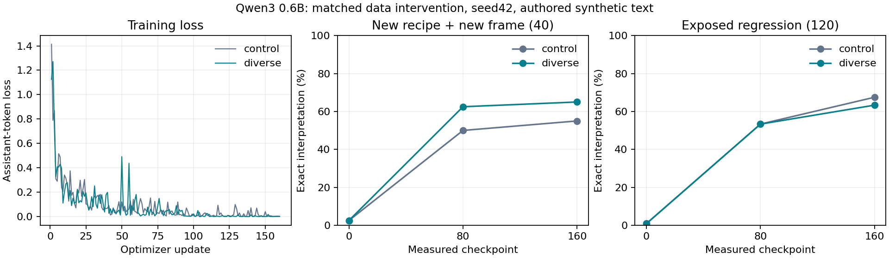

# התערבות נתוניםv4 — שיפור משמעותי במסגרות שנלמדו, פער בניסוח חדש

16 בנובמבר2026. **הנתונים המגוונים שיפרו את הפענוח, אך ההתערבות לא עברה את השער שנקבע ואין קידום למוצר.** כלל הפיתוח עלה96→133 מתוך160; בקבוצה הראשית שבה גם המתכון וגם הניסוח חדשים השיפור קטן יותר,22→26 מתוך40. הרגרסיה הישנה ירדה81→76 מתוך120, עם יותר עובדות לא מבוססות. שתי ההרצות הסתיימו, התוצרים אומתו וה־T4 שוחררה.

## ההשוואה שבוצעה

מקור ותוכנית הוקפאו ב־`2af4c8b` לפני הקצאתGPU; כלי השחזור והאימות ב־`1471971`. שתי התאמות חדשות מאותוQwen3 0.6B, אותה גרסת משקולות, FP16 ו־LoRA rank8/alpha16 עלq/k/v/o, seed42,160 עדכונים ואותן הגדרות בדיוק. בכל זרוע360 דוגמאותTRAIN ו־640 חשיפות כולל חזרות. control השתמש בנתוניTRAIN המקוריים; diverse החליף אותם בחבילה מגוונת יותר באותם שישה מתכונים, כולל יותר חלקיות וריבוי פסוקיות. זו התערבות משולבת במגוון, במשקל המשפחות, בצירופים ובאורך, ולא בידוד של כל גורם בנפרד.

בשתי הזרועות אותה הבהרה חדשה: `currentStep` הוא ניווט ולא עוגן לכינוי. לכן ההשוואה הקובעת היא בין שתי הזרועות הנוכחיות, ולא מול82/120 הישן. נבדקו **זהות מלאה של טקסט וטוקנים בנקודת0**, אותו גיבוב גוף קפוא ואותו סדר640 אינדקסי דוגמאות. האופטימייזר והמנוע המקורי נשארו ללא שינוי. לאחר האימון גיבוב הגוף נשאר זהה בכל זרוע; רק2,293,760 פרמטרי המתאם אומנו.

160 מקרי פיתוח בארבעה תאים,80 זוגות תואמים: בין שני ניסוחים נשמרו מתכון, מצב, היסטוריה ופירוש צפוי.40 המקרים שבהם גם המתכון וגם המסגרת חדשים הם המדד הראשי;120 האחרים אבחון.120 מקריv3 הם רגרסיה שנחשפה, ללא שינוי וללא אימון עליהם. בוצעו1,680 פלטי מקרה חוזרים ב־0/80/160, לא1,680 תרחישים עצמאיים.

כל הדוגמאות מלאכותיות ותוויותיהן נכתבו בידי העוזר, ללא ביקורת אדם. הפעולות במתכונים סומנו מראש בקוד; לא נבדק פירוק אוטומטי של מתכון לפעולות. בתאים המוכרים כינויים כלליים עשויים לחזור עם הקשר אחר, אך אין קלט מלא זהה ל־TRAIN. ״ניסוח מוכר״ הוא ביחס ל־diverseTRAIN; תאים אלו אינם הוכחת הכללה לשפה שלא נלמדה. לא נפתחו המבחנים השמורים או80 המקרים הישנים.

## תוצאות בנקודה הקבועה160

| מדד | control | diverse |
|---|---:|---:|
| פלט תקין בפיתוח | 160/160 | 160/160 |
| פירוש מלא בכל הפיתוח | 96/160 | **133/160** |
| רשימת עובדות מדויקת בפיתוח | 107/160 | 144/160 |
| מצב מוצע נכון בפיתוח | 124/160 | 146/160 |
| שינויי מצב נדרשים בפיתוח | 66/90 | 79/90 |
| עובדות שגויות כשאין דיווח, בפיתוח | 18/48 | **2/48** |
| שינוי מוצע שגוי בפועל, ניתוח משני | 25/160 | 5/160 |
| פירוש מלא בקבוצה הראשית, חדש/חדש | 22/40 | **26/40** |
| שינויי מצב נדרשים בקבוצה הראשית | 17/23 | **16/23** |
| עובדות שגויות כשאין דיווח, בקבוצה הראשית | 4/12 | 1/12 |
| פירוש מלא ברגרסיה הישנה | **81/120** | 76/120 |
| שינויי מצב נדרשים ברגרסיה | 40/60 | 44/60 |
| עובדות שגויות כשאין דיווח, ברגרסיה | **10/38** | 14/38 |

״פירוש מלא״ דורש עובדות, כוונה והבהרה נכונות יחד. מצב נכון לבדו יכול להסתיר עובדה חסרה כאשר המצב כבר מתאים; לכן הוא אינו המדד היחיד. אי־ביצוע מפורש חייב להישאר עובדה ולא להיעלם כ־no-op. שני פלטיdiverse ברגרסיה נדחו, ונשארו במכנה ככשלים. בכל הפיתוח שתי הזרועות כבר מחזירות פורמט תקין, כך שההפרש ביניהן אינו רק שיפורJSON כפי שהיה חלק ניכר משיפורv3.

הפלטים הם הצעות מחקריות בלבד; לא הוחל שום שינוי באפליקציה. גםpending לא מבוסס הוא עובדה שגויה: הוא יכול למחוק דיווח קודם. אין לשלב שגיאות אין־דיווח בפיתוח וברגרסיה לממוצע אחד שמסתיר את הרגרסיה. מונה השינוי השגוי המשני בודק כל עובדה מול המצב הקודם והצפוי; שדה`unsafe_state` הגולמי הישן אינו מונה כזה.

## ההבחנה החדשה: ניסוח לעומת מתכון

| מתכון | מסגרת ניסוח | control | diverse |
|---|---|---:|---:|
| מוכר | מוכרת | 27/40 | **40/40** |
| מוכר | חדשה | 25/40 | 27/40 |
| חדש | מוכרת | 22/40 | **40/40** |
| חדש | חדשה — המדד הראשי | 22/40 | **26/40** |

ב־diverse:80/80 במסגרות שנלמדו, מול53/80 במסגרות חדשות. לכן בניסוי הזה המודל מסוגל לשייך דיווחים גם למתכון חדש כשהמסגרת הלשונית מוכרת; שינוי הניסוח עדיין קשה לו, גם כשהמתכון מוכר. הזוגות תואמים בקלט ובתווית פרט לניסוח, ולכן הם מחדדים את הפער הזה. יש רק שני מתכונים בכל קבוצת מוכרות ודוגמאות תלויות; אין מכאן הוכחה שכל פער בעולם נובע רק מהמסגרת או שתוויות העוזר חפות מעמימות.

אין לתאר80/80 כיכולת שיחה כללית או כשינון קלטים זהים: הקלטים המלאים נפרדים מ־TRAIN, אך מסגרות המשפט חזרו. מנגד, אין לתאר את המודל כמבין רק משפטים פשוטים. בפיתוח המשותף חלקיות עלתה7→13 מתוך16, וריבוי פסוקיות1→11 מתוך16. זה שיפור בפענוח מורכב במסגרות מוגדרות, שעדיין אינו עמיד לניסוח חופשי.

## מה נשבר ואיך נבחר ההמשך

דוגמאותdiverse בקבוצה הראשית: ״נעצרתי לפני הסוף, אחרי שכבר התחלתי לגרר את הגזרים״ סווג כהשלמה; ״כבר התחלתי לפרוס את הפטריות, ונשאר לי עוד לסיים את הפעולה״ סווג גם הוא כהשלמה. בדיווח עם ביצוע ברור וספק על פעולה נוספת, נשמט לפעמים יעד ההבהרה. שאלה כמו ״כיצד ממשיכים ... מההוראה לגרר ...?״ יצרה עובדה חלקית אף שאין דיווח ביצוע. שני מקרי אין־הדיווח השגויים בפיתוח היו שאלה זו ודיווח ספק על שטיפת אורז.

ברגרסיה הישנה: חלקיות השתפרה1→12 מתוך12, אך ספק ירד8→4 מתוך12 והפניה להיסטוריה/עמימות10→6 מתוך12. מתוך14 מקרי העובדות השגויות ללא דיווח, שבעה הם ספק, שישה הפניה עמומה ואחד ציטוט/ניסוח. ההחלפה הכוללת שלTRAIN השיגה כיסוי טוב יותר למסגרות החדשות תוך אובדן חלק מהישנות. אין להסיק שהוספת עוד דוגמאות תמיד גורמת לכך; כאן החלפנו חבילת נתונים ומשקלי משפחות, ולא הוספנו replay של כל המקור.

**ההכרעה המוקפאת לא עברה:**26/40 נמוכים מ־32/40;16/23 שינויי מצב נמוכים מ־80%; בפיתוח נותרו2 עובדות שגויות במקרי אין־דיווח במקום אפס; וברגרסיה14 שגיאות כאלו לעומת10. פער4/40 כן עומד בתנאי השיפור, וירידה5/120 עומדת בגבול6 שנקבע לציון הרגרסיה, אבל אין בכך כדי לבטל את התנאים שנכשלו.133/160 אינם תחליף למדד הראשי. אין שינוי ספים או בחירתcheckpoint אחר בדיעבד.

ההמשך שנבחר להכנה הוא **תמהיל שימור של דוגמאותTRAIN קודמות יחד עם הדוגמאות המגוונות**, בדגש על ספק והפניה עמומה, במקום החלפה מלאה. אין להשתמש במקרי הפיתוח/הרגרסיה עצמם כדוגמאות אימון. מטרת התערבות כזו תהיה לבדוק אם אפשר לשמור את רווח החלקיות וריבוי הפסוקיות בלי לאבד את ההבחנות הישנות; היא אינה הבטחה לפתור את פער הניסוח החדש. קודם יקובעו תמהיל, תקציב ושערים, ורק אחריהם יוחלט על הרצה. בסבב הזה לא הוכנה או הופעלה עוד זרוע, לא הוחלף מודל ולא נוספו צעדים.

## משך האימון, משאבים ומגבלות

ב־diverse הפירוש הראשי עלה25→26 בין80 ל־160, אך הכיסוי שם ירד17→16 ונוספה עובדה לא מבוססת אחת. בכלל הפיתוח עלה123→133. loss האחרון היה כ־0.00145 ב־diverse וכ־0.00203 ב־control. זו התאמה טובה לדוגמאות האימון, לא הוכחת הכללה או התכנסות סופית. **אין ראיה שנקבע גבול קיבולת ב־160 או שכל הארכה תזיק; גם אין כאן בסיס להאריך צעדים לבדם אוטומטית.**

הגרף מתארseed אחד בלבד. בקווי הוולידציה נמדדו רק0/80/160; הקווים המחברים אינם מדידות נוספות או רווחי סמך. נתוניloss מייצגים דוגמאות שונות בשתי הזרועות ואינם מדד איכות שיחה בפני עצמם.

T4 אמיתי, Python3.13.16, Torch2.6.0+cu124, Transformers4.57.1 ו־PEFT0.17.1. control ארך613.6שניות ו־diverse600.7;job כולל התקנה ארך1370.3שניות והבעלות כולל הקצאה/התאוששות1424.6שניות. סדר הזרועות קבוע וה־cache משותף, לכן אין לפרש הבדל בזמני טעינה כהשפעת הנתונים. זמניbatch אינם זמני תגובת משתמש.

ה־peak שנצפה במוניallocated היה3,596,409,344B וב־diverse3,635,360,768B. מוניreserved הגיעו בהתאמה ל־14,877,196,288B ול־13,893,632,000B. הפעם נשמרו גם המונים לפני איפוס הבסיס; אין אובדן שיאbaseline כפי שתועד בסבב הקודם. אלה מוניGPU בסביבת אימון עםcache, לא אומדןVRAM מינימלי ולא תקציבRAM לדפדפן/טלפון.

נשמרו ארבעהcheckpoint עם מתאמים, אופטימייזרים ומצביRNG, כל תגובות המודל ועקומות האימון. שחזור אימון מאמצעcheckpoint לא נבדק. בסיסQwen הציבורי, הרישיוןApache2.0 וה־revision/SHA נשארו כמתועד בתוכנית. סביבתColab שוחררה ונבדק שאין ריצות פעילות. לא נשלח תוכן משתמש להסקה; הועלו רק קוד ודוגמאות מלאכותיות לפי ההרשאה הקיימת. לא שונו האפליקציה, הטיימרים, Capacitor אוAndroid/iOS.

זהו פענוח דיווחים וסיווג כוונה בלבד. שאלות כמות/סדר אינן נבדקות כאן כתשובה נכונה או בחירת מרכיב; אין כימות, יצוא, דפדפן, טלפון פיזי, דיבור מטבח, ASR/TTS או שיחה מלאה. כל המבחנים השמורים נשארו סגורים. השער המקוצר של הניסוי אינו מחליף את ספי המוצר המחמירים.

[תוצאות מאומתות, תאים וכל הכשלים](verification/sparse-recipe-results-v4-20261116.json) · [תוכנית קפואה](SPARSE_RECIPE_DATA_V4_PLAN.he.md) · [שחזור](SPARSE_RECIPE_DATA_V4_REPRODUCTION.he.md) · [שימור שמונת הארכיונים הקודמים](verification/sparse-recipe-legacy-integrity-v4-20261116.json).

[חבילת שחזור מלאה](dist/ourRecipes-sparse-data-comparison-20261116.zip),103,084,292B, כוללת את מקור הניסוי, הנתונים, הגרף וארכיון התוצאות המקורי עם ארבעת המתאמים ומצבי האימון. אין בה משקולות בסיס או פרטי חשבון. אומתוCRC וכל46 רשומותmanifest, ו־17 בדיקות קוד/נתונים עברו מתוך החבילה המחולצת. [גיבוב ומטא־נתונים](verification/sparse-recipe-packet-v4-20261116.json). החבילה משמרת את הדוח לפני הוספת פסקת קישור זו; הארכיונים הקודמים לא שוכתבו.
