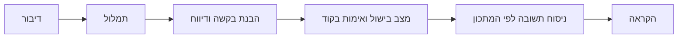

# מה רוצים ומה בודקים — עוזר מתכונים קולי מקומי

עדכון16 בנובמבר: סדר הביצוע והחלטות ההתקדמות מנוהלים כעת ב[תוכנית העבודה הראשית](PROJECT_WORK_PLAN.he.md). מסמך זה נשמר כתיאור ארכיטקטורה והצעות מ־13 בנובמבר; רשימת הבדיקות בהמשך אינה מסלול עבודה מתחרה.

13 בנובמבר 2026. זהו מסמך המיקוד הנוכחי, בעקבות בקשת המשתמש לעשות סדר ולבחון גם את נתיב. בחירת מודל היא אמצעי: היעד הוא שיחה עברית בסיסית, מדויקת ושימושית לפי מתכון ומצב בישול, במשאבים שמתאימים ככל האפשר לטלפון רגיל בדפדפן.

## המוצר הנדרש

העוזר מבין דיווחי ביצוע ואי־ביצוע, ביצוע חלקי, שתי פעולות במשפט ותיקונים. הוא עונה מה עכשיו, מה עדיין לא דווח שבוצע, ומה כתוב במתכון. הוא מפריד בין המתכון לעצה נוספת, אינו ממציא כמויות ומבקש הבהרה כשאין מספיק מידע. מעבר למתכון אחר מבודד את המצב. כל הדיבור והטקסט נשארים במסלול המקומי; שירות חיצוני דורש בחירה מפורשת. כפתורים נשארים חלופה שימושית.

## שלושת שלבי הקול

1. **תמלול, STT:** קול מהמשתמש הופך לטקסט. זה רכיב נפרד, והוא עלול לטעות גם במילה שמשנה משמעות, כגון "לא".
2. **מוח:** פירוש הטקסט בהקשר המתכון והשיחה, החלטה מה לעדכן, וניסוח תשובה. מצב הבישול והאימות שייכים לקוד. אין הכרח שמודל יחיד יבצע את כל התפקידים בתוך המוח.
3. **הקראה, TTS:** טקסט התשובה הופך לקול. הרכיב אינו מתקן תשובה שגויה. האזנה מופסקת בזמן ההקראה כדי למנוע תמלול של קולה של המערכת.

למוח יש שלוש שכבות נפרדות: הבנה; קוד שמחזיק שלב נוכחי ופעולות שבוצעו/בוצעו חלקית/נותרו; ומענה. לשאלת המשך רגילה אפשר להרכיב תשובה מהוראת המתכון. ניסוח חופשי והסבר גמיש הם תפקיד אפשרי למודל שיחה. המתכונים עצמם מסופקים כנתונים ואינם צריכים להישנן במשקולות.

## המקום האפשרי של נתיב

[נתיב](https://huggingface.co/yoavipo/nativ-he-decision) הוא מועמד להבנה ולהחלטות: מקבל טקסט, שאלה ואפשרויות, ומדרג את האפשרויות. אינו מחולל תשובות שיחה. לדיווח עם שתי פעולות אין להסתפק בשאלה שמאלצת לבחור פעולה יחידה; אפשר לשאול על כל פעולה רלוונטית מה דווח: בוצעה, טרם בוצעה, בוצעה חלקית, מסויגת או לא הוזכרה.

דוגמת יעד: "הוספתי מים אבל עוד לא ערבבתי" אמור להניב מים=בוצע וערבוב=טרם בוצע, אם הפעולות קיימות במתכון. הקוד מאמת מזהים, מתכון/גרסה, סתירות ומעברים; ורק אחר כך מפיק תשובה. נתיב יכול גם להיבדק כבודק סמנטי להצעת LLM. הסכמה בין שני מודלים אינה הוכחה לאמיתות, ואין להחיל את הסתברויות הכיול של בנצ׳מרק אחר כאילו הן כוילו למתכונים.

נתיב עדיין לא הורץ אצלנו על מקרי המתכון ולא אומתה המרה שלו לדפדפן. יש לבדוק יצוא מתאים, כיווץ, איכות אחרי הכיווץ, זיכרון ומהירות. שני מודלים יחד עלולים לדרוש יותר משאבים; השילוב אינו בהכרח פתרון קטן יותר.

## סדר עבודה שמכריע בין החלופות

1. **הבנה בטקסט:** לבדוק נתיב על פירוש דיווחים, ספק, חלקיות, תיקון והפניה לפעולות; להשוות לפלטי המודלים שכבר נשמרו. זו בדיקת הבנה, לא עדיין הוכחת שיחה או דפדפן.
2. **שלושה מבנים אפשריים, לפי תועלת מדודה:** נתיב וקוד לתשובות מבוססות מתכון; מודל שיחה קטן וקוד מאמת; או שילוב שבו נתיב משפר באופן מדיד את הבנת/בדיקת ההצעות ומודל השיחה מספק ניסוח והסבר. יש להשוות על אותם מקרים. אין להוסיף מודל נוסף כברירת מחדל בלי יתרון ברור בדיוק מול עלותו.
3. **דפדפן:** למועמד שעובר איכות בסיסית לבדוק את פורמט הדפדפן המדויק, הורדה, ביטול, מטמון ומחיקה, זמן לתשובה וזיכרון. לנתיב יש לבחון קודם אם אפשר לייצא מודל מתאים ולשמר את התוצאות. נתוני Python אינם נתוני דפדפן.
4. **קול ומכשיר:** לחבר לתמלול ולהקראה הקיימים בהוכחת היתכנות נפרדת, לבדוק גם שגיאות תמלול ומניעת משוב, ולבסוף למדוד בטלפון אמיתי. אמולציה/Chromium בענן מסומנים בנפרד.
5. **אימון:** אם זוהה מועמד מתאים למשאבים עם כשלים ממוקדים, להשוות התאמה למשימה מול אותה ביקורת שלא אומנה. אין הבטחה מראש שאימון קטן יפתור כל קושי, ואין לפתוח מבחנים שמורים כדי לכוון את השיטה.

זהו סדר בדיקה מוצע; שלב נתיב טרם בוצע ואין כאן תוצאת שילוב. אין כעת צורך לשנות את האפליקציה, הטיימרים או מעטפת המובייל כדי לבדוק אותו.

## מה כבר ידוע

קיימות בדיקות היתכנות קודמות של תמלול Zipformer עברי והקראה מקומית ב־Chromium בענן, כמתועד ב־`../../docs/VOICE_POC.md`; אין בכך אישור לטלפון אמיתי או לעמידה בכל יעדי השהיה. בניסוי השיחה הזעירה האחרון הושלמו 40 פלטי מתכון ועוד 8 בקרות על WASM CPU: המודלים נטענו אך הדיוק לא הספיק. נתיב לא נבדק באותן הרצות. [התוצאות והגבולות](TINY_BROWSER_RECIPE_RESULTS.he.md).

המדדים הקובעים: פירוש דיווח, שינוי מצב נדרש לעומת שינוי שגוי, טיפול נכון בהבהרה ותיקון, תשובה שנשענת על המתכון, וזמן/זיכרון של כל המסלול. JSON חוקי, ציון ביטחון גבוה או טעינה מוצלחת לבדם אינם הצלחה. יעד המשאבים מתייחס לכל החוויה ולא רק למודל השפה; המספרים בתוכניות קודמות הם יעדי ניסוי מוצעים, לא דרישות מספריות שהמשתמש קבע.

סבב זה ארגן את התוכנית בלבד. לא בוצעו הסקה או אימון חדשים, ולא שונו משקולות, מבחנים, קוד אפליקציה או קובצי מובייל.
